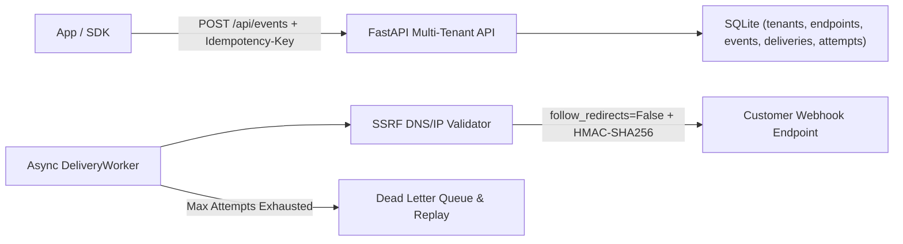

# HookRelay

Production-oriented multi-tenant webhook delivery, HMAC rotation, retry/DLQ, and event management platform with Python and TypeScript SDKs.

## Overview & Problem Statement

Reliably dispatching outbound webhooks requires idempotency, cryptographic signing with zero-downtime secret rotation, exponential backoff retries, Dead Letter Queues, delivery attempt inspection, and strict SSRF defenses against internal network probing. HookRelay provides a self-hosted FastAPI control plane, async SQLite delivery worker, real-time SSE stream, web console, and Python/TypeScript receiver SDKs.

## Features

- **Multi-Tenant Isolation & Scoped API Keys**: Separate tenant workspaces, SHA-256 hashed `hr_live_...` API keys, key revocation, and sliding-window rate limiting.
- **SSRF Protection**: Rejects non-HTTP(S) URLs, embedded credentials, localhost/metadata hostnames, loopback, RFC1918, link-local, CGNAT, and redirects (`follow_redirects=False`).
- **HMAC-SHA256 Signing & Dual-Secret Rotation**: Emits `X-HookRelay-Signature: t=<unix>,v1=<hex>,v0=<prev_hex>` during rotation grace windows (`POST /api/endpoints/{id}/rotate-secret`).
- **Retries, Backoff, DLQ & Replay**: Configurable `max_attempts`, `base_delay_ms`, and `backoff_multiplier`, per-attempt HTTP status/body inspection, endpoint health states (`healthy`, `degraded`, `circuit_open`), single/bulk DLQ replay, and `Idempotency-Key` deduplication.
- **Python & TypeScript SDKs**: Ready-to-use `HookRelayClient` and constant-time `verifySignature` / `verify_signature` helpers under `sdk/python` and `sdk/typescript`.

## Quick Start

1. **Requirements**: Python 3.11+
2. **Clone**: `git clone https://github.com/fully-ai/hookrelay.git && cd hookrelay`
3. **Install**: `./scripts/install.sh` (Windows: `.\scripts\install.ps1`)
4. **Configure**: Copy `.env.example` to `.env` and set `HOOKRELAY_ADMIN_TOKEN`
5. **Start**: `./scripts/dev.sh` (Windows: `.\scripts\dev.ps1`)
6. **Open**: `http://127.0.0.1:8093`
7. **Run Tests**: `./scripts/test.sh` (Windows: `.\scripts\test.ps1`)
8. **Stop**: `Ctrl+C` (or `docker compose down`)

## Configuration & Environment Variables

| Variable | Default | Description |
| --- | --- | --- |
| `HOOKRELAY_HOST` | `127.0.0.1` | Bind host |
| `HOOKRELAY_PORT` | `8093` | HTTP port |
| `HOOKRELAY_DATA_DIR` | `./data` | SQLite directory |
| `HOOKRELAY_ADMIN_TOKEN` | `hookrelay-dev-admin` | Admin header (`X-Admin-Token`) for tenant bootstrap |
| `HOOKRELAY_ALLOW_PRIVATE_TARGETS` | `false` | Keep `false` in production; `true` allows local webhook targets in dev |
| `HOOKRELAY_RATE_LIMIT_PER_MIN` | `120` | Per-tenant requests/minute |

## API & SDK Usage

```python
from hookrelay_sdk import HookRelayClient, verify_signature

client = HookRelayClient("http://127.0.0.1:8093", "hr_live_...")
client.publish_event("order.created", {"orderId": "ord-42"}, idempotency_key="ord-42")
ok = verify_signature(raw_body, request.headers["X-HookRelay-Signature"], "whsec_...")
```

## Architecture



## Docker Deployment

```bash
HOOKRELAY_ADMIN_TOKEN="replace-with-strong-token" docker compose up --build -d
docker compose logs -f
docker compose down
```

## Contributing & License

See [CONTRIBUTING.md](CONTRIBUTING.md), [SECURITY.md](SECURITY.md), and [LICENSE](LICENSE) (Apache 2.0).
